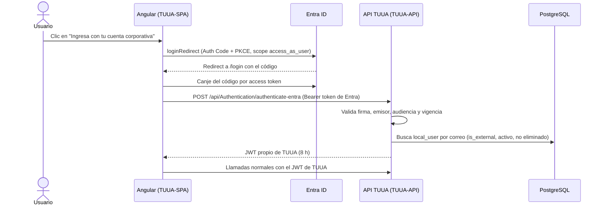

# Guía de configuración de Entra ID

[Volver al inicio](../README.md)

TUUA admite dos formas de iniciar sesión:

| Tipo de usuario | `local_user.is_external` | Autenticación | Autorización |
| --- | --- | --- | --- |
| Local | `false` | Correo y contraseña almacenados en `local_user` | Roles de TUUA |
| Corporativo | `true` | Cuenta de Microsoft Entra ID ("Ingresa con tu cuenta corporativa") | Roles de TUUA |

Entra ID **solo autentica**. Los roles y permisos se siguen administrando en la pantalla **Usuarios** de TUUA. No se usan roles ni grupos de Entra ID para autorizar.

## Flujo



Después del canje, el frontend trabaja igual que con un usuario local: guarda el JWT de TUUA en `localStorage` y el menú se arma con los roles de `local_user`.

Se crean **dos App Registrations** en el mismo tenant:

- **TUUA-API**: representa la API y publica el scope `access_as_user`.
- **TUUA-SPA**: representa el frontend Angular (cliente público, sin secreto).

## Requisitos

- Rol **Application Administrator** o **Cloud Application Administrator** en el tenant (o **Global Administrator** para dar el consentimiento de administrador).
- La URL pública del frontend en cada ambiente (por ejemplo `http://localhost:4200` y `https://tuua.tudominio.com`).

## 1. App Registration de la API (TUUA-API)

1. En [portal.azure.com](https://portal.azure.com) → **Microsoft Entra ID** → **App registrations** → **New registration**.
2. Completa:
   - **Name**: `TUUA-API` (agrega el sufijo del ambiente si usas un registro por ambiente, por ejemplo `TUUA-API-DEV`).
   - **Supported account types**: *Accounts in this organizational directory only (Single tenant)*.
   - **Redirect URI**: déjalo vacío.
3. Clic en **Register**. En **Overview** anota:
   - **Application (client) ID** → `<tuua-api-client-id>`.
   - **Directory (tenant) ID** → `<tenant-id>`.
4. **Expose an API**:
   1. Junto a **Application ID URI**, clic en **Add** y acepta el valor propuesto `api://<tuua-api-client-id>`. Guarda.
   2. **Add a scope**:
      - **Scope name**: `access_as_user`
      - **Who can consent?**: *Admins and users*
      - **Admin consent display name**: `Acceder a TUUA`
      - **Admin consent description**: `Permite que TUUA inicie sesión con la cuenta corporativa del usuario.`
      - **State**: *Enabled*
5. **Manifest**: busca `"requestedAccessTokenVersion"` (en el manifiesto antiguo, `"accessTokenAcceptedVersion"`) y cámbialo a `2`. Guarda.
   La API valida el emisor `https://login.microsoftonline.com/<tenant-id>/v2.0`; si el token se emite en versión 1 la validación falla.
6. **Token configuration** → **Add optional claim** → **Access** → marca `email` y `upn` → **Add**. Si el portal lo solicita, acepta agregar el permiso `email` de Microsoft Graph.

La API obtiene el correo del claim `preferred_username`; `email` y `upn` se usan como respaldo.

## 2. App Registration del frontend (TUUA-SPA)

1. **App registrations** → **New registration**:
   - **Name**: `TUUA-SPA`.
   - **Supported account types**: *Single tenant*.
   - **Redirect URI**: plataforma **Single-page application (SPA)**, valor `http://localhost:4200/login`.
2. Clic en **Register** y anota el **Application (client) ID** → `<tuua-spa-client-id>`.
3. **Authentication**:
   - En la plataforma *Single-page application*, agrega las URIs de cada ambiente, siempre terminadas en `/login`:
     - `http://localhost:4200/login`
     - `https://tuua.tudominio.com/login`
   - **Front-channel logout URL** (opcional): `https://tuua.tudominio.com/login`.
   - No marques *Access tokens* ni *ID tokens* en *Implicit grant*: MSAL usa Authorization Code con PKCE.
4. **Certificates & secrets**: no crees secretos; es un cliente público.
5. **API permissions**:
   1. **Add a permission** → **My APIs** (o **APIs my organization uses**) → `TUUA-API` → **Delegated permissions** → `access_as_user` → **Add permissions**.
   2. Confirma que `Microsoft Graph / User.Read` esté presente (viene por defecto).
   3. Clic en **Grant admin consent for <tenant>** y confirma. El estado de ambos permisos debe quedar en *Granted*.

### Opcional: restringir quién puede autenticarse

Por defecto, cualquier usuario del tenant puede autenticarse en Entra ID, aunque solo entrarán a TUUA los que estén registrados en `local_user`. Para limitarlo también en Entra ID:

1. **Enterprise applications** → `TUUA-SPA` → **Properties** → **Assignment required?** = *Yes* → **Save**.
2. **Users and groups** → **Add user/group** y asigna los usuarios o grupos autorizados.

## 3. Configurar la aplicación

### Backend (`AAP_TUUA.API/appsettings.json` o variables de entorno)

```json
"EntraId": {
  "Instance": "https://login.microsoftonline.com/",
  "TenantId": "<tenant-id>",
  "ClientId": "<tuua-api-client-id>",
  "Audience": "api://<tuua-api-client-id>"
}
```

| Clave | Variable de entorno | Valor del portal |
| --- | --- | --- |
| `EntraId:Instance` | `EntraId__Instance` | `https://login.microsoftonline.com/` (con la barra final) |
| `EntraId:TenantId` | `EntraId__TenantId` | **Directory (tenant) ID** (GUID; no uses el dominio) |
| `EntraId:ClientId` | `EntraId__ClientId` | **Application (client) ID** de TUUA-API |
| `EntraId:Audience` | `EntraId__Audience` | **Application ID URI** de TUUA-API |

### Frontend (`AAP_TUUA_FRONTEND/src/environments/environment*.ts`)

```ts
entra: {
  clientId: '<tuua-spa-client-id>',
  tenantId: '<tenant-id>',
  apiScope: 'api://<tuua-api-client-id>/access_as_user',
},
```

El `redirectUri` se calcula como `<origen actual>/login`, por lo que debe estar registrado en TUUA-SPA para cada ambiente.

### Base de datos

Aplica `AAP_TUUA.Dao/migrations/migration_20261011_001.sql`. Permite contraseñas nulas para los usuarios corporativos y crea un índice único sobre `lower(email)`. Si el índice falla, primero elimina los correos duplicados.

## 4. Habilitar un usuario corporativo en TUUA

1. Inicia sesión en TUUA con un usuario administrador.
2. **Usuarios** → **Nuevo usuario**.
3. Ingresa el nombre y el **correo corporativo exactamente como aparece en Entra ID** (UPN, por ejemplo `jperez@lima-airport.com`). La comparación no distingue mayúsculas.
4. Activa **Cuenta corporativa (Entra ID)**. Los campos de contraseña se ocultan.
5. Asigna los roles y guarda.

El usuario entra con **Ingresa con tu cuenta corporativa**. Un usuario corporativo no puede entrar con correo y contraseña, y un usuario local no puede entrar con Entra ID.

## 5. Verificación

1. Abre `http://localhost:4200/login` y pulsa **Ingresa con tu cuenta corporativa**.
2. Inicia sesión con una cuenta del tenant que esté registrada en TUUA como corporativa.
3. Debes volver a `/login` y pasar automáticamente al inicio, con el menú de los roles asignados.
4. Con una cuenta del tenant que no esté registrada, debe aparecer *Tu cuenta corporativa no está habilitada en TUUA*.

## Solución de problemas

| Síntoma | Causa probable | Solución |
| --- | --- | --- |
| `AADSTS50011: The redirect URI ... does not match` | La URI `<origen>/login` no está registrada como **SPA** en TUUA-SPA. | Agrégala en **Authentication** de TUUA-SPA, con el mismo esquema, host, puerto y ruta. |
| `AADSTS65001: The user or administrator has not consented` | Falta el consentimiento del permiso `access_as_user`. | **API permissions** → **Grant admin consent**. |
| `AADSTS500011: The resource principal named api://... was not found` | `apiScope` del frontend no coincide con el Application ID URI. | Revisa **Expose an API** de TUUA-API y `environment*.ts`. |
| `AADSTS50105` (usuario no asignado) | *Assignment required* está activo y el usuario no está asignado. | Asigna el usuario o su grupo en **Enterprise applications**. |
| Mensaje *Tu cuenta corporativa no está habilitada en TUUA* (403/401) | El correo no existe en `local_user`, el usuario no es corporativo, está inactivo o eliminado; o la API rechazó el token. | Verifica el usuario en **Usuarios**. Si existe, revisa el log de la API: un error de *audience* indica `EntraId:ClientId`/`Audience` incorrectos y un error de *issuer* indica `TenantId` incorrecto o un token v1 (paso 1.5). |
| El botón redirige pero al volver no inicia sesión | Caché de MSAL en un estado inválido. | Cierra la pestaña (la caché está en `sessionStorage`) e intenta de nuevo. |
